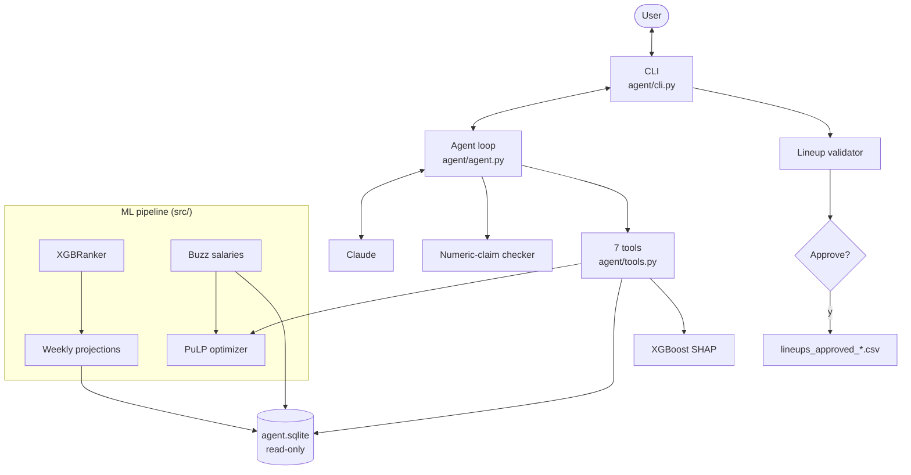

# PGA Fantasy Golf

A machine learning pipeline for predicting PGA Tour player performance and generating optimal weekly lineups for [Buzz Fantasy Golf](https://buzzfantasygolf.com).

## How it works

1. **Historical data** (2015–2022, 36,843 player-tournament rows) is loaded and standardized — strokes gained stats, course history, cut rates.
2. **Feature engineering** computes rolling averages (8/16/24 tournament windows) per player. Every window is computed with `shift(1)` applied first, so a tournament's features only ever see earlier tournaments — no look-ahead leakage.
3. **XGBoost `XGBRanker`** (LambdaRank, `rank:ndcg`) is trained to rank a field by `prize_pct` — each player's share of the tournament purse — rather than regressing on a fantasy-points proxy. Validated with expanding-window cross-validation: train on seasons ≤ N, test on N+1.
4. **Weekly scraper** fetches the live field and each player's recent form from the PGA Tour GraphQL API.
5. **Optimizer** solves a salary-cap integer program (PuLP) to maximize projected performance within the weekly budget.
6. **Analyst agent** answers plain-English questions about the rankings ("why is Scheffler below Si Woo Kim?", "build 2 lineups with Scheffler locked") by calling the pipeline through tools, with a human approval step for lineups and an eval suite. See [Analyst agent](#analyst-agent) below.

## Results

Expanding-window temporal CV, scored by per-tournament Spearman rank correlation (ranking is what
lineup selection needs — not absolute error):

| Test season | Train | Rows | Tournaments | Spearman ρ (mean) |
|---|---|---|---|---|
| 2018 | 2015–2017 | 4,863 | 34 | +0.266 |
| 2019 | 2015–2018 | 5,047 | 35 | +0.258 |
| 2020 | 2015–2019 | 4,216 | 29 | +0.274 |
| 2021 | 2015–2020 | 5,615 | 38 | +0.316 |
| 2022 | 2015–2021 | 3,653 | 26 | +0.278 |
| **Overall** | | | | **+0.278** (σ 0.022) |

Reproduce with `python -m src.model --cv`.

These figures are measured *after* the train/serve parity fix — training previously used an EWM over
a player's full career while inference used a flat mean of recent events, so the model was scored on
a feature distribution it never trained on. Closing that gap lowered the reported CV score slightly,
which is the point: the earlier number was partly measuring a bias the live pipeline couldn't
reproduce. Verify with `python -m tests.test_feature_parity`.

Two tournament-type model variants were built and backtested against this baseline — a links-course
variant and a FedEx Cup Playoffs variant. The links variant is a marginal improvement; the playoff
variant **underperformed the base model** on playoff events, since ~23 historical playoff editions is
far too thin to train an 800-tree ranker on. It's kept behind an explicit `--playoff` opt-in rather
than auto-selected. Negative results are cheaper to keep than to rediscover.

## Analyst agent

An LLM agent (Claude) that answers questions about the model by calling the pipeline as tools. It never states a number from memory: every figure must come from a tool, and a deterministic check flags any that don't.

```
> Where is Kim ranked this week?
Several golfers match "Kim," so I need to know which one you mean: Si Woo Kim, Tom Kim, Michael Kim, ...

> Tom
Tom Kim is ranked 4th this week at the TOUR Championship (East Lake), with a score of 0.6973.
The field is 30 players, and the ranking uses the nocut model.

[get_rankings; 6,752 in / 168 out tokens; trace 7b18e33ba78d]
```

### Architecture



- **A hand-written loop, no agent framework** (`agent/agent.py`). It calls Claude with the tool schemas, runs the tools it asks for, and sends all results back in one message. It stops at an answer, after 8 model calls, or after 3 minutes. Every model call and tool call is logged to `traces/YYYY-MM-DD.jsonl`.
- **Specific tools, not raw SQL**, each returning compact JSON and structured errors the agent can read:

| Tool | What it does |
|---|---|
| `resolve_player` | Name → player id, via exact, partial or fuzzy match. Ambiguous names come back as candidates for the agent to ask about; a fuzzy hit is never auto-picked. |
| `get_rankings` | An event's ranked field. Picks the variant `predict` would use (links / nocut / base). |
| `get_player_features` | A player's model inputs for an event. |
| `explain_prediction` | Exact per-feature SHAP contributions from XGBoost, for one player or the gap between two. Refuses (`model_changed`) if the saved model no longer reproduces the stored score. |
| `value_report` | Players whose model rank beats their salary rank. |
| `propose_lineups` | Runs the optimizer with locks, excludes and budget. Returns a proposal and **saves nothing**. |
| `model_performance` | Per-event Spearman (same calculation as `--cv`), top-10 hits, and the winner's model rank. |

- **Human in the loop.** After a turn that proposed lineups, the CLI prints them from the *tool output*, not the agent's summary, and asks `Approve? [y/N]`. Only a yes writes `lineups_approved_{id}.csv` into that week's folder. The agent has no save tool.
- **Deterministic guardrails** (`agent/guardrails.py`), with no LLM involved:
  - The **numeric-claim checker** extracts every number from an answer and checks it against the tool results, the user's words and our own tool docs. It allows for rounding, $K/$M amounts and percentages. Flagged numbers are shown under the answer.
  - The **lineup validator** re-checks every proposal against the database's salaries before it can be approved: roster size, cap, locks, excludes and distinct lineups.

### Evals

44 questions (`evals/questions.jsonl`): 30 across lookups, explanations, value, lineups and guardrails, plus 14 deliberately hard ones:
- multi-turn follow-ups;
- wrong premises ("why is Scheffler #1?" when he's 5th);
- "rounds vs starts" wording traps;
- a counterintuitive SHAP explanation;
- questions whose natural answer tempts the model into arithmetic.

Expected answers are **generated from the database by running the tools**, so they stay correct as new weeks arrive. Grading is **code, not an LLM judge**: names, numbers within tolerance, required explanation drivers, lineups validated against what the user asked for, and tool-trace checks for clarifying or refusing.

**Baseline, Haiku 5.5 vs Opus 5.5:**

| | Claude Haiku 5.5 | Claude Opus 5.5 |
|---|---|---|
| Accuracy | 42/44 (95%) | 43/44 (98%) |
| Hard cases | 12/14 | 13/14 |
| Answers with unsupported numbers | 5% | 5% |
| Avg cost / latency per question | $0.0014 / 4.2s | $0.055 / 8.7s |

Haiku comes within one case of Opus at about 1/40 the cost.

**Iteration 1.** Both models' main failure was summing contributions themselves when asked for a "net effect". One prompt rule fixed it: report the tool's figure (`score_gap`), never your own arithmetic. Haiku 5.5, means of 3 runs each way, graded identically:

| | Before | After |
|---|---|---|
| Accuracy | 95.5% | **97.7%** |
| Hard cases | 85.7% | **92.9%** |
| Answers with unsupported numbers | 6.8% | **0.8%** |

Every change is logged with its before and after numbers in [`evals/CHANGELOG.md`](evals/CHANGELOG.md), and the per-run reports are in `evals/results/`.

### Lessons learned

- **A failing eval is evidence about the agent, the grader, *or* the case.** In the first hard run, 2 of 5 failures were mine. A grader missed "strokes-gained over the last 24 starts" as total strokes gained. And one case contradicted the agent's own instruction to ask about ambiguous names. Read the failing answers before changing the agent.
- **A perfect score is a warning.** The first 30 cases scored 30/30 on the cheapest model, so they couldn't measure improvement. That's why the 14 hard cases exist.
- **Fix the ruler before measuring the thing.** Opus first showed 20% unsupported numbers, mostly checker noise ("top 10", table row numbers). `run_evals --rescore` re-grades saved traces at no API cost, so grader fixes are measured on the *same* answers rather than on a fresh, noisy run.
- **Single runs are noisy.** One case flipped between two identical runs, so changes are judged on repeated runs (`evals.compare`).
- **The numeric checker is weaker than it looks.** In data-heavy answers, loosely rounded numbers often match some unrelated value by coincidence. It's reliable against made-up precise figures, and treated as a signal, not proof.

### Running it

Needs `ANTHROPIC_API_KEY`.

```bash
python -m agent.db                                   # build data/processed/agent.sqlite from local outputs
python -m agent.cli                                  # ask questions; /new starts over, /quit exits
python -m agent.cli --model claude-haiku-5-5 "Who are the best value plays this week?"

python -m evals.generate                             # regenerate cases from the current DB
python -m evals.run_evals --model claude-haiku-5-5   # run all 44 (about $0.06 on Haiku)
python -m evals.run_evals --rescore evals/results/<run>.json   # re-grade a saved run, no API calls
python -m pytest tests/                              # 111 tests, no API calls
```

**Known limitations:**
- Explanations only work for the TOUR Championship and The Open, the live weeks whose saved models still reproduce their scores. The base model was retrained after the other weeks were scored.
- Live course-history features are always empty. `scrape.py` looks up each player's history at the course by PGA API player id, but the training data uses different ids (Scheffler is 46046 in one, 9478 in the other). The agent DB's crosswalk links the two; the live pipeline doesn't use it yet.
- The project is on Python 3.8, which pins the Anthropic SDK to 0.72; newer request options go through `extra_body`.

## Project structure

```
src/
├── paths.py       # Single source of truth for all filesystem paths
├── ingest.py      # Load and standardize historical CSV data
├── features.py    # Rolling SG averages, course history, cut rate
├── pipeline.py    # Build historical feature matrix
├── model.py       # XGBRanker training, temporal CV, model variants
├── scrape.py      # PGA Tour GraphQL API fetcher
├── predict.py     # Weekly inference
├── buzz.py        # Buzz Fantasy Golf salary parser
└── optimizer.py   # PuLP lineup optimizer
agent/
├── db.py          # Read-only SQLite DB + cross-source player crosswalk
├── tools.py       # The agent's 7 tools and their JSON schemas
├── prompts.py     # System prompt
├── agent.py       # Hand-written tool-use loop with JSONL traces
├── guardrails.py  # Numeric-claim checker + lineup validator
└── cli.py         # Multi-turn CLI with the lineup approval step
evals/
├── generate.py    # Builds questions.jsonl from the DB
├── grade.py       # Deterministic graders
├── run_evals.py   # Runner, reports, --rescore
├── compare.py     # Multi-run before/after
└── CHANGELOG.md   # Every change with before/after numbers
tests/             # pytest suite (no API calls)
```

## Setup

```bash
pip install -r requirements.txt
```

You'll also need the historical data CSV at `data/raw/historical/14-22 practice data.csv` to build the training feature matrix and model. It's gitignored and not fetched by any script, so it must already exist locally.

## Weekly workflow

**1. (One-time) Build the historical model**
```bash
python -m src.pipeline          # builds data/processed/feature_matrix.parquet
python -m src.model             # trains and saves models/model_base.pkl
```

**2. Every week before the tournament**
```bash
# Scrape fresh field + player form, then score
python -m src.predict --tournament R2026026 --top 30

# Optimize lineups against your salary file
python -m src.optimizer --csv salaries.csv --budget 1650000 --lineups 3
```

Replace `R2026026` with the current tournament ID (visible in the PGA Tour schedule URL) and adjust `--budget` to match that week's Buzz cap.

**Salary file format** (`salaries.csv`):
```
name,salary
Scottie Scheffler,700000
Rory McIlroy,577000
...
```
The parser also handles the copy-paste block format directly from the Buzz website.

## Optimizer options

```bash
# Force a player into every lineup
python -m src.optimizer --csv salaries.csv --budget 1650000 --lock "Scheffler"

# Exclude a player
python -m src.optimizer --csv salaries.csv --budget 1650000 --exclude "Smith, Cameron"

# Generate 5 alternative lineups
python -m src.optimizer --csv salaries.csv --budget 1650000 --lineups 5
```

## Pool rules (Buzz Fantasy Golf)

- Pick **6 players** per week
- Total salary must be within the weekly cap (varies by field size/strength)
- Scoring is based on **real prize money** earned at the tournament

## Notes

- Players with no recent SG data (amateurs, qualifiers) are automatically excluded from projections.
- Course history features are populated from the historical dataset for training. Rare venues (e.g. Shinnecock Hills) will have sparse history. At weekly inference they're currently empty; see the agent's [known limitations](#running-it).
- `src/scrape.py` uses PGA Tour's public web-client API key, which ships in their site bundle. Override it with `PGA_API_KEY` if they rotate it.
